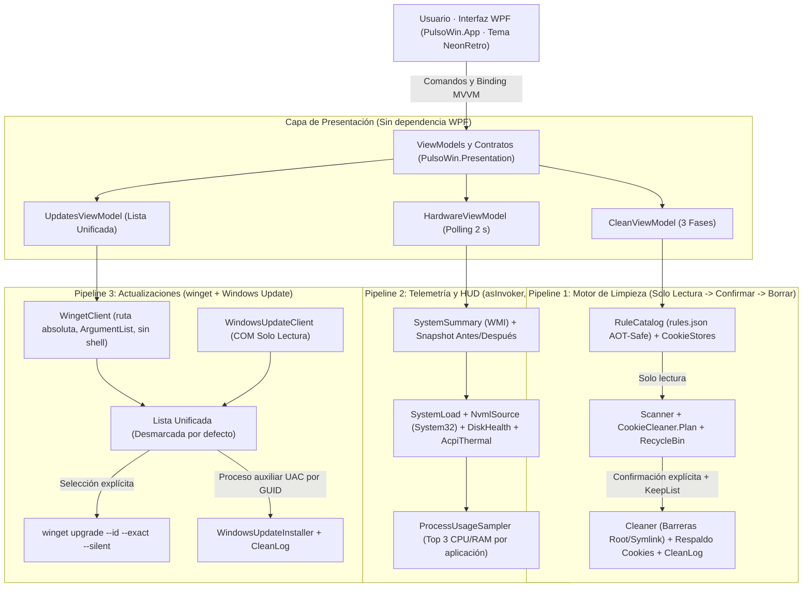

<div align="center">

# 🎮 PulsoWin
### *Limpiador seguro, visor de hardware en vivo y gestor unificado de actualizaciones para Windows 10/11*

[](LICENSE)
[](https://dotnet.microsoft.com/download/dotnet/10.0)
[](#-arquitectura-y-flujos-de-ejecución)
[](#-compilar-probar-y-verificación)
[](#-decisiones-de-diseño)
[](#-estándares-de-ingeniería-y-trazabilidad)

<p align="center">
  <b>Gratis, transparente y de código abierto (MIT).</b><br>
  <i>Muestra exactamente qué va a tocar antes de ejecutar, corre sin privilegios por defecto, no toca el registro y no instala drivers de kernel vulnerables.</i>
</p>

[Qué hace hoy](#-qué-hace-hoy) • [Arquitectura y Flujos](#-arquitectura-y-flujos-de-ejecución) • [Estándares y Trazabilidad](#-estándares-de-ingeniería-y-trazabilidad) • [Decisiones de Diseño](#-decisiones-de-diseño) • [Compilar y Probar](#-compilar-probar-y-verificación) • [Créditos](#-créditos-y-desarrollo)

</div>

---

## 🎯 Qué es PulsoWin (y qué NO hace a propósito)

Limpiador y visor de hardware en una sola app para Windows 10/11, pensado para quien quiere mantener su PC (por ejemplo, para jugar) sin instalar herramientas que prometen milagros ni cargar servicios opacos en segundo plano.

- **Estado actual:** **`v0.3.0`**. Compila sin advertencias con el SDK de .NET 10 y pasan las **119 pruebas** (motor y ViewModels). Probado en un equipo (Intel + NVIDIA Quadro + NVMe/SATA), en sesión normal y elevada; se agradecen reportes de otros equipos.

> 🔐 **Para ver las opciones de red por proceso, PulsoWin debe ejecutarse como Administrador.**
> Al abrir, la app **pide permiso de administrador** (aviso UAC de Windows). Con él, la pestaña **RED** y el Modo Gadget
> muestran el consumo exacto **por proceso** (PID, programa, descarga, subida y total de la sesión) vía ETW.
> Si rechazas el aviso, PulsoWin abre igual en **modo usuario estándar**: la red se muestra **por interfaz**
> (Ethernet, Wi-Fi…) y un aviso lo indica. Para no ver el aviso al abrir: `PulsoWin.exe --sin-admin`.
- **Qué no hace (a propósito):** no promete más FPS, no «optimiza» la RAM y no limpia el registro. Borrar cachés libera espacio, pero no acelera un PC sano; la caché de shaders, de hecho, conviene dejarla (viene desactivada por defecto).

---

## ⚙️ Qué hace hoy

### 1. Limpiar (sin administrador)
- **Temporales y sistema:** archivos temporales del usuario (solo con más de 24 h), caché de miniaturas, volcados de errores y papelera de reciclaje.
- **Navegadores (multi-perfil):** caché de Chrome, Edge y Firefox en **todos** los perfiles. Si el navegador está abierto, la regla se bloquea y avisa sin tocar archivos.
- **Cookies selectivas con respaldo:** conservan los dominios configurados (`google.com` conserva también `mail.google.com`). Solo opera con el navegador cerrado y siempre guarda copia previa en `%LOCALAPPDATA%\PulsoWin\respaldos-cookies`.
- **Flujo estricto en tres fases:** **Analizar** (solo lectura) → **Confirmar** (muestra archivos y tamaño exacto) → **Borrar**. Cada lote deja bitácora en `%LOCALAPPDATA%\PulsoWin\logs`.
- **Métrica Antes / Después:** compara espacio libre en disco, % de RAM en uso y temperatura máxima leída.

### 2. HUD Neón Retro (cabecera siempre visible)
- **Telemetría instantánea + Top 3:** uso de CPU, uso de RAM, temperatura de GPU y espacio liberable, cada uno con los 3 procesos/programas que más consumen (agrupados como en el Administrador de tareas) y las 3 categorías que más espacio liberan.
- **Botón `▶ START`:** salta a **Limpiar** e inicia el análisis; el mando retro de la cabecera se anima mientras el motor trabaja.

### 3. Hardware (sin administrador ni driver de kernel)
- **Resumen del equipo:** SO, CPU, RAM por módulo, placa base, BIOS, GPU y discos vía WMI.
- **Sensores en vivo cada 2 s:** CPU y RAM (`SystemLoadSource`), GPU NVIDIA (temperatura, ventilador en % y uso vía `System32\nvml.dll`), salud y temperatura de discos (API de almacenamiento de Windows) y zonas térmicas ACPI.
- **Honestidad de telemetría:** lo que el hardware o Windows no expone aparece como **«no disponible»**, nunca inventado ni en cero.

### 4. Actualizar (`winget` + Windows Update dentro de PulsoWin)
- **Buscar (solo lectura):** consulta `winget` y Windows Update Agent (COM) en segundo plano y consolida todo lo pendiente en **una sola lista** con tamaño honesto (lee `MinDownloadSize` y `MaxDownloadSize`).
- **Proceder:** nada viene marcado por defecto (selección explícita o casilla de tres estados en cabecera).
  - Programas: `winget.exe upgrade --id <id> --exact --silent` con ruta absoluta del ejecutable, validación estricta de ID y sin shell.
  - Parches de Windows: proceso auxiliar acotado (`ElevatedUpdates` / `WindowsUpdateInstaller`) que solicita **un** permiso UAC y solo acepta identificadores con formato GUID. Avisa si requiere reinicio; nunca reinicia solo.
- Cada lote de actualización queda auditado en `%LOCALAPPDATA%\PulsoWin\logs`.

### 5. Red (tráfico en vivo, Top 10) — por proceso requiere Administrador
- **«Aquí te muestro tu tráfico de red actual (los primeros 10)»:** se refresca **cada 1 s**, ordenado por descarga + subida, con PID, proceso, descarga y subida (KB/s o MB/s) y total de la sesión (B/KB/MB/GB, base 1024).
- **Como Administrador:** ETW del kernel (`TraceEvent`, sesión propia con `StopOnDispose`), bytes exactos **por proceso**. La sesión se cierra al salir: no quedan sesiones del kernel huérfanas.
- **Sin Administrador:** tráfico real **por interfaz** activa (sin loopback ni las copias de filtros del driver) y el aviso «Modo usuario estándar…». Nunca falla por falta de permisos.

### 6. Modo Gadget (tablero flotante)
- Botón **«◔ Modo Gadget»** en la cabecera: oculta la app completa y muestra una ventana flotante **sin detener el monitoreo**.
- **5 diales con aguja animada** (suavizada, se refrescan cada 1 s): **Red** (velocidad con escala automática + total de la sesión), **CPU**, **RAM** (con `X.X / Y.Y GB`), **GPU** (uso) y **Temp GPU** (°C). Arco verde → amarillo (&gt;70) → rojo (&gt;85).
- Sin bordes, translúcida, fuera de la barra de tareas, arrastrable, **siempre visible** (📌) e ícono en la bandeja del sistema. Doble clic o **⤢** vuelve a la app completa.
- **Sin drivers de kernel ni temperatura de CPU** (no choca con antitrampas como Vanguard): CPU con `GetSystemTimes`, RAM con `GlobalMemoryStatusEx`, GPU con NVML (driver normal de NVIDIA) o los contadores de Windows.

---

## 🏛️ Arquitectura y Flujos de Ejecución

PulsoWin separa de forma estricta **motor determinista** (`PulsoWin.Core`), **lógica de pantalla testeable** (`PulsoWin.Presentation`) y **capa visual** (`PulsoWin.App`), manteniendo un flujo de dependencias unidireccional (`Core → Presentation → App`).



---

## 📐 Estándares de Ingeniería y Trazabilidad

| # / Patrón o Estándar | Descripción Técnica | Archivos Clave | Commit |
| :--- | :--- | :--- | :--- |
| **1. Arquitectura Orientada a Dominios y Flujo Unidireccional (`Core → Presentation → App`)** | Adaptación a .NET MVVM del patrón `alan2207/bulletproof-react`: separación por dominios (`Cleaning`, `Sensors`, `Updates`, `Common`) con flujo unidireccional hacia los ViewModels, permitiendo testear pantallas sin instanciar WPF. | `src/PulsoWin.Core/*`<br>`src/PulsoWin.Presentation/ViewModels/*`<br>`src/PulsoWin.App/*` | [`45d4b2e`](https://github.com/Leonthelee/PulsoWin/commit/45d4b2e) |
| **2. Estándar Frontend Web / Cockpit (`alan2207/bulletproof-react` + `vitejs/vite-plugin-react`)** | Contrato de referencia para futura interfaz web/cockpit: arquitectura por dominios (`shared → features → app` en `frontend/src/features/`), `App.tsx` / `provider.tsx` / `dashboard.tsx`, `api-client.ts` centralizado, `GlobalErrorBoundary` y toolchain `@vitejs/plugin-react` (JSX Runtime automático, Fast Refresh HMR `:5173`, alias `@/*` → `./src/*`, proxy `/api` → `:8090`, build `frontend/dist`). | Estándar web del ecosistema (`df899e6`: `App.tsx`, `provider.tsx`, `api-client.ts`, `vite.config.ts`, `package.json`, `tsconfig.json`) | [`45d4b2e`](https://github.com/Leonthelee/PulsoWin/commit/45d4b2e) *(equivalente MVVM)* |
| **3. Motor de Limpieza en 3 Fases y Barreras Anti-Borrado** | Escaneo en solo lectura, bloqueo automático si el navegador está abierto, rechazo de raíces críticas (`C:\`, perfil, Windows, Program Files, AppData, Documentos, Escritorio), ignorar `ReparsePoint`/symlinks, re-validación por archivo y respaldo SQLite de cookies antes de borrar filas por dominio. | `src/PulsoWin.Core/Cleaning/Scanner.cs`<br>`src/PulsoWin.Core/Cleaning/Cleaner.cs`<br>`src/PulsoWin.Core/Cleaning/CookieCleaner.cs`<br>`src/PulsoWin.Core/Cleaning/RuleRoots.cs` | [`057c1a9`](https://github.com/Leonthelee/PulsoWin/commit/057c1a9) |
| **4. Catálogo Declarativo AOT-Safe (`System.Text.Json` Source Generator)** | Reglas declarativas en JSON embebido deserializadas con `JsonSerializerContext` (cero reflexión en runtime, compatible con `PublishAot` y trimming) y validación contra `..` o rutas absolutas. | `src/PulsoWin.Core/Cleaning/RuleCatalog.cs`<br>`src/PulsoWin.Core/Cleaning/CleanRule.cs`<br>`src/PulsoWin.Core/Cleaning/rules.json` | [`ea77ad3`](https://github.com/Leonthelee/PulsoWin/commit/ea77ad3) |
| **5. Actualizador Unificado Seguro (`winget` + Windows Update COM)** | `ProcessRunner` con `UseShellExecute = false` y `ArgumentList` (cero inyección de shell), resolución segura de `winget.exe`, regex estricto de ID, consulta WUA en solo lectura y auxiliar elevado acotado exclusivamente a GUIDs. | `src/PulsoWin.Core/Updates/ProcessRunner.cs`<br>`src/PulsoWin.Core/Updates/WingetClient.cs`<br>`src/PulsoWin.Core/Updates/WindowsUpdateClient.cs`<br>`src/PulsoWin.Core/Updates/WindowsUpdateInstaller.cs`<br>`src/PulsoWin.App/ElevatedUpdates.cs` | [`a746c69`](https://github.com/Leonthelee/PulsoWin/commit/a746c69)<br>[`630017d`](https://github.com/Leonthelee/PulsoWin/commit/630017d)<br>[`c9a862c`](https://github.com/Leonthelee/PulsoWin/commit/c9a862c) |
| **6. HUD Neón Retro, Ícono Reproducible y Top 3 por Proceso** | Tema visual WPF propio sin librerías de terceros, cabecera estable sin saltos de layout, ícono multi-resolución generado por código (`tools/icon.cs`) y muestreo diferencial de CPU/RAM agrupado por aplicación. | `src/PulsoWin.App/Themes/NeonRetro.xaml`<br>`src/PulsoWin.App/Controls/RetroPadHero.xaml`<br>`src/PulsoWin.Core/Sensors/ProcessUsageSampler.cs`<br>`tools/icon.cs` | [`45d4b2e`](https://github.com/Leonthelee/PulsoWin/commit/45d4b2e)<br>[`c9a862c`](https://github.com/Leonthelee/PulsoWin/commit/c9a862c)<br>[`2d5813b`](https://github.com/Leonthelee/PulsoWin/commit/2d5813b)<br>[`4cc6d0d`](https://github.com/Leonthelee/PulsoWin/commit/4cc6d0d) |
| **7. Build Determinista, Higiene de Binarios (`REA`) y Firma de Autoría** | Compilación reproducible con `Deterministic=true`, `PathMap`, supresión de rutas locales del `.pdb` en el encabezado PE CodeView (`RSDS`) en `Release` (`ContinuousIntegrationBuild=true`, `DebugType=none`) e incrustación de firma de autoría en `AssemblyMetadata` (`Author`, `Profile`, `HelloDev`), auditado con REA (`0` fugas locales). | `Directory.Build.props`<br>`global.json` | [`88eb5b8`](https://github.com/Leonthelee/PulsoWin/commit/88eb5b8)<br>[`857b739`](https://github.com/Leonthelee/PulsoWin/commit/857b739) |

---

## 🛡️ Decisiones de diseño

| Decisión | Por qué |
|---|---|
| Pide administrador al abrir, pero no lo exige | El manifiesto sigue en `asInvoker`: la app se relanza elevada solo si aceptas el aviso (necesario para la red por proceso con ETW). Si lo rechazas, abre igual en modo estándar; `--sin-admin` se salta el aviso. |
| Front y back separados (MVVM) | `Core` (lógica) ← `Presentation` (estado y comandos, testeable sin ventanas) ← `App` (vistas WPF). |
| Sin driver de kernel en el MVP | WinRing0 está en la lista de drivers vulnerables (Defender lo detecta, CVE-2020-14979) y Windows 11 la aplica por defecto. |
| Cookies: borrar filas por dominio, sin descifrar | El dominio se guarda en claro (`host_key` en Chromium, `host` en Firefox); el cifrado app-bound de Chrome no impide borrar. |
| No escribir en la base de un navegador abierto | Evita corrupción y bloqueos de SQLite. |
| Reglas declarativas en JSON propio (`rules.json`) | Añadir limpiezas sin tocar código; validación que rechaza rutas absolutas, `..` y patrones con rutas. |
| Barreras de seguridad en el borrado | Nunca usa como raíz la unidad, el perfil, Windows, Program Files, AppData, Documentos ni el Escritorio; no sigue enlaces ni uniones; vuelve a comprobar cada archivo antes de borrar. |
| Fuera de alcance | Limpiador de registro y «optimizador de RAM»: no hay evidencia independiente de beneficio y sí de riesgo. |
| DLL nativas solo desde System32 | Evita secuestro de DLL (`nvml.dll`, `shell32`, `kernel32`). |

---

## 🗂️ Estructura

```text
PulsoWin.slnx
Directory.Build.props             versión, builds reproducibles, strip PDB en Release y firma AssemblyMetadata
global.json                       SDK .NET 10.0.100 (rollForward: latestFeature)
src/
├── PulsoWin.Core/                motor: Cleaning, Sensors, Updates, Common (0 dependencia de UI)
├── PulsoWin.Presentation/        ViewModels MVVM y servicios desacoplados de WPF
└── PulsoWin.App/                 front WPF, tema Neón retro, Assets/pulsowin.ico y auxiliar elevado
tests/
└── PulsoWin.Tests/               suite xUnit (119 pruebas unitarias y de ViewModels)
tools/
└── icon.cs                       generador reproducible del ícono multi-resolución
```

---

## 🧪 Compilar, Probar y Verificación

Requisito: [SDK de .NET 10](https://dotnet.microsoft.com/download/dotnet/10.0) (LTS). .NET 8 dejó de tener soporte en noviembre de 2026.

```powershell
# 1. Ejecutar toda la suite de pruebas (119/119 en verde)
dotnet test --nologo

# 2. Compilar en Release tratando advertencias como errores (sin rutas locales en RSDS)
dotnet build -c Release --no-incremental -warnaserror --nologo

# 3. Ejecutar la aplicación de escritorio
dotnet run --project src/PulsoWin.App
```

---

## 🚀 Próximos pasos

1. Probar en equipos reales (con y sin GPU NVIDIA, NVMe y SATA).
2. GPU AMD con ADLX.
3. Proceso elevado acotado para caché de Windows Update (detener `bits`, `wuauserv` y `cryptsvc`) y `cleanmgr /sagerun`.
4. Extensión con `chrome.browsingData` para limpiar con el navegador abierto (desde Chrome 136 el DevTools Protocol ya no sirve sobre el perfil normal).
5. Sensores de placa como módulo opcional (LibreHardwareMonitorLib con PawnIO), solo tras probarlo con Memory Integrity y la lista de bloqueo activas.
6. Distribución: firma de código (Authenticode) y build protegido. En 2017 CCleaner se distribuyó con malware y firma válida porque comprometieron su entorno de build.

---

## 👥 Créditos y desarrollo

- **Autoría y dirección:** Daniel Elías Díaz Lepe ([@Leonthelee](https://github.com/Leonthelee))
- **Co-desarrollo y revisión cruzada:** Claude (Opus 5.5 · Anthropic) y Antigravity Orquestador (Gemini 4 · Google)

---

## 📄 Licencia y avisos

[MIT](LICENSE). Puedes usarlo, modificarlo y redistribuirlo libremente, sin garantía de ningún tipo: revisa qué vas a borrar antes de confirmar.

PulsoWin es un proyecto independiente, escrito desde cero. No está afiliado, patrocinado ni respaldado por Gen Digital, Piriform, CCleaner ni Speccy, que son marcas de sus respectivos dueños y se mencionan solo como referencia.

Dependencias: `Microsoft.Data.Sqlite` y `System.Management` (MIT), `SQLitePCLRaw` (Apache-2.0); pruebas con `xUnit` (Apache-2.0).

Historial de versiones y cómo volver atrás: [CHANGELOG.md](CHANGELOG.md).
